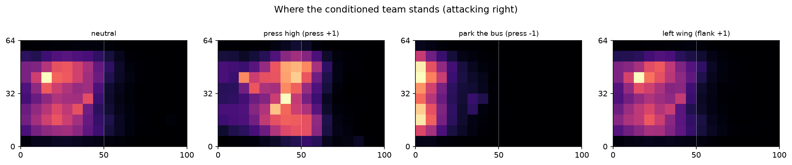

# CoachableFC: Self-Play Deep RL for 2D Football

CSE 4633 Artificial Intelligence midterm and final project · Utkarsh Upadhyay (solo)

**Play it in the browser:** <https://utkarsh-upadhyay9.github.io/CoachableFC/>
· **Report:** [report/REPORT.md](report/REPORT.md)


This project trains agents to play a small top-down 1v1 football game with
PPO and self-play, from scratch, on a laptop CPU, and lets you play against
them. The agent sees a 16-number state vector (positions and velocities from
its own point of view) and picks one of 18 actions (move direction × kick).

## Results at a glance

- With an **opponent pool** of past checkpoints, Elo rises steadily over 30M
  steps, to about +300 over a random player. Later checkpoints beat earlier
  ones in 83–89% of pairings.
- **Latest-only self-play collapses.** It peaks at 5.7M steps, then the two
  copies settle into a 100%-draw equilibrium, and the final agent loses 79%
  of games to the scripted bot.
- **Reward shaping** mainly speeds up the first few million steps. The
  sparse-reward run catches up by about 8M steps.
- The final agent wins **80%** of games against a "chase the ball and shoot"
  bot and **70%** against a random player (where most of the remaining games
  are draws).


## Final project: 2v2 with a coachable teammate

**Report:** [report/FINAL_REPORT.md](report/FINAL_REPORT.md)

The same game with two players per team. One network controls both
teammates, and a conditioned version also takes a 4-number tactic (press,
flank, spread, possession). A local LLM, run through Ollama, turns a typed
tactic like "park the bus" into those numbers.

- The tactic-conditioned team is the strongest 2v2 team (+348 Elo over a
  random team), and it follows three of its four tactics: press, spread and
  possession. Left/right play has no effect.
- With ten times the tactic reward it follows all four, but stops winning
  (9% vs the scripted chase team).
- Latest-only self-play collapses into 100% draws again, from 42.3M steps.
- Keyword matching with the LLM as a fallback reads 92.7% of tactic values
  correctly on held-out phrases, better than keywords (88.5%) or the LLM
  alone (79–88%).



```bash
brew install ollama && ollama serve &        # optional, for typed tactics
ollama pull qwen2.5:3b-instruct
python scripts/serve_demo.py                 # web demo + coach at http://localhost:8000, pick Format: 2v2
python scripts/play.py --team                # pygame 2v2; T cycles the teammate's tactic
```

Without the local server (for example on the [live demo](https://utkarsh-upadhyay9.github.io/CoachableFC/)),
the coach box still works: phrases are matched by the same keywords in
JavaScript (`docs/js/coach.js`, checked against Python by a test), and
anything else goes to Qwen2.5 1.5B running in your browser with
[WebLLM](https://github.com/mlc-ai/web-llm). That needs WebGPU, and the
first use downloads about 880 MB, which the browser then caches. Without
WebGPU only the keywords and the preset buttons work. The browser model is
weaker than qwen2.5 3B: on the held-out phrases the in-browser hybrid gets
78.1% of tactic values right (`results/2v2/coach_bench_browser.json`).

After changing the keywords or the prompt in `football/coach.py`, run
`python -m football.coach` to rewrite `docs/js/coach.json`.

## Layout

```
football/
  core.py        vectorized numpy physics for N games at once
  env.py         Gymnasium single-agent wrapper
  render.py      pygame renderer
  bots.py        random and chase-the-ball scripted opponents
  policy.py      actor-critic MLP, checkpoints
  ppo.py         PPO + GAE
  selfplay.py    self-play trainer (opponent pool / latest-only)
  evaluate.py    matches, cross-play round robin, Elo fit
  tactics.py     2v2 tactic vectors and their behavior features
  stats.py       2v2 coordination and tactic metrics
  coach.py       text -> tactic (keywords, then a local Ollama model)
scripts/
  train.py             train a run
  sanity_cartpole.py   PPO sanity check on CartPole-v1
  crossplay.py         cross-play heatmap + Elo curve for one run
  ablations.py         final agents vs bots and each other
  plot_curves.py       learning curves
  play.py              play against an agent with the keyboard (pygame)
  record.py            record matches to GIF
  export_web.py        export policies to JSON for the browser
  eval_2v2.py          2v2 baselines, coordination, head-to-head
  tactics_eval.py      does the conditioned team follow its tactic?
  coach_bench.py       coach accuracy and latency benchmark
  serve_demo.py        web demo server with the /coach endpoint
  web_figures.py       copy 2v2 figures and GIFs into docs/figures/ for the page
docs/            the GitHub Pages site (JS port of the game + policy inference)
models/          selected checkpoints (final.pt is the final agent; 2v2/ has the 2v2 teams)
runs/            per-run config, metrics.csv and final checkpoint
results/         figures and evaluation outputs
report/          the write-up
```

## Quick start

```bash
python -m venv .venv && source .venv/bin/activate
pip install -r requirements.txt

python scripts/play.py --agent models/final.pt            # play (arrows/WASD + Space)
python scripts/play.py --agent models/final.pt --fps 15   # slower, easier
python scripts/play.py --watch --agent models/final.pt --opponent chase

python scripts/train.py --name my_run                     # ~16 min for 30M steps on an M5
python -m pytest -q

python -m http.server -d docs                             # the browser version, at http://localhost:8000
```

See the report for the full set of commands used to produce every figure.
