# Language-Conditioned 2v2 Self-Play Football

Utkarsh Upadhyay · CSE 4633 Artificial Intelligence · Final project (solo)

This extends the midterm project (`report/REPORT.md`) from 1v1 to 2v2 and adds
a coach: you type a tactic, a small language model running locally turns it
into numbers, and a trained teammate plays that way. Every number below comes
from a file in `results/2v2/`.

## 1. Question

Can two teammates that share one policy learn to play 2v2 under self-play, and
does the midterm's opponent pool still prevent the draw collapse? Can a typed
tactic, turned into a numeric vector by a local LLM, change how a trained team
plays without retraining it?

**Short answer:**

- **2v2 learning:** it works, with caveats. The best pool run reaches +287 Elo
  over a random team, and later checkpoints beat earlier ones in 92% of
  pairings. The second pool seed stalled at +130 with 91% self-play draws, so
  seed variance is even larger than in the midterm.
- **Latest-only collapse:** it comes back in 2v2. Elo peaks at 22.9M steps,
  and from 42.3M steps on, 100% of its self-play games end 0–0.
- **Tactic conditioning:** with a small tactic reward, the team follows three
  of the four tactics: how high it plays, how far apart the two players stay,
  and how much it goes after the ball. The left/right tactic has no effect.
  This run is also the strongest team overall: +348 Elo, and it loses only 4%
  of games to the scripted chase team.
- **Larger tactic reward:** with ten times the weight, the team follows all
  four tactics strongly, including left/right, but it stops winning (9% wins
  against the chase team). Following orders and winning pull against each
  other.
- **Coach:** keyword matching with the LLM as a fallback reads 92.7% of tactic
  dimensions correctly on held-out phrases. That beats either method alone:
  keywords 88.5%, qwen2.5 3B 79.2%, qwen2.5 7B 87.5%.
- **Coordination:** the teams pass little. The best team completes about one
  pass per game, and both players often chase the ball together.

## 2. Environment

The midterm game (`football/core.py`), generalized to `players_per_team`
P ∈ {1, 2}. 1v1 output is bit-identical to the midterm code (checked over
2000 steps × 256 games), and the midterm tests, models and demo still work.

- **Field, ball, players, actions:** unchanged. Field 100 × 64 with 20-unit
  goals, 18 discrete actions (9 moves × kick on/off), and episodes that end on
  a goal or after 400 steps.
- **Kickoff:** in 2v2 each team has one player forward at (35, 22.4) and one
  back at (15, 41.6), mirrored for the other team, with the midterm's
  kickoff noise.
- **Observations:** 24 numbers per player, all ego-centric with x mirrored
  for team 1. The first 16 keep the 1v1 layout: self, nearest opponent, ball,
  ball relative to self, cooldown and time left. Then come 4 for the teammate
  (position and velocity) and 4 for the farther opponent. Opponents are sorted
  by distance to self, so swapping the two opponents does not change the
  input.
- **Reward:** +1/−1 shared by both teammates, plus the midterm's
  potential-based shaping computed per team, decaying to zero over the first
  half of training.
- **Fairness:** ball-contact order rotates over all four players. Two copies
  of the scripted chase team, over 4000 games, win 33.7% from the left side
  and 35.2% from the right, with 31.1% draws (about one standard error
  apart). Random vs random wins 10.1% vs 9.9%.
- **Speed:** with random actions and 256 parallel games, the physics runs at
  1.26M env-steps/s in 1v1 and 447k in 2v2 (`env_checks.json`).
- **Parity:** the browser's JavaScript physics was generalized the same way.
  The parity test now steps both versions in 1v1 and in 2v2 and compares
  positions, ball, all observations, touches, goals and the chase bot's
  actions to 1e-9.

**Scripted 2v2 team** (`TeamChaseBot`): the player nearer the ball plays the
midterm chase bot. The other holds a spot 30% of the way from its own goal to
the ball, and clears the ball if it comes within reach in front of it. It
beats a random team 89.8 / 7.5 / 2.7 % (W/D/L, 1000 games).

## 3. Method

**Parameter sharing.** One actor-critic network (2×128 tanh, the midterm
PPO settings) controls both players of the learner's team. Each env step
gives two samples, one per player, so a rollout of 64 games × 128 steps
gives 16,384 samples. The opponent team is a frozen network controlling both
of its players.

**Opponents.** This is the midterm recipe. *Pool:* each of the 8 blocks of
games faces the latest copy with probability 0.5, otherwise a uniformly
sampled past snapshot (one saved every 10 updates). *Latest:* every block
faces the latest copy.

**Tactic conditioning** (`football/tactics.py`). A tactic is a vector z with
four values in [−1, 1]. Each value has a behavior feature, computed from the
team's own side, that doubles as its adherence metric:

| z | feature f, per step | +1 means |
|---|---|---|
| `press` | mean x of the two players, scaled to [−1, 1] | camp in the opponent half |
| `flank` | mean y of the two players, scaled to [−1, 1] | stay on the left wing |
| `spread` | (teammate distance − 25) / 25, clipped | stay 50 units apart |
| `possession` | +1 if one of ours is nearest the ball, else −1 | win the ball |

In the conditioned run, every team gets its own z per episode: 30% of
episodes are neutral (z = 0), and otherwise each value is active with
probability 0.5 and uniform in [−1, 1]. z is appended to every observation
(28 inputs), and the reward gets an extra w · Σ z_k f_k per step. At z = 0
this term is exactly zero (tested). Frozen opponents get their own random z,
so the learner also meets teams that press, sit deep or spread out.

One deliberate change from the plan: the tactic reward is **not** annealed.
Annealing it to zero, like the shaping, would remove the only reason to
follow z by the end of training. Instead it is kept small. At w = 0.002,
following one tactic value perfectly for a full 400-step game is worth at
most 0.8, less than one goal.

**Coach** (`football/coach.py`). It takes text and returns z. A keyword
parser (with negation like "don't press" and mild wording like "a bit more")
handles the phrases it recognises. Anything else goes to an Ollama model on
localhost, with a JSON-schema output format, temperature 0, a fixed seed and
a few-shot system prompt. The output is clamped to [−1, 1], and anything
invalid becomes 0. If Ollama is down, the keyword result is used. Every call
is logged to JSONL. The LLM runs only when the tactic changes, never inside
training or the game loop.

Each 50M-step run took 52–66 minutes on an Apple M5 MacBook Air, with four
or five runs training at once.

## 4. Runs

| run | opponents | tactic input | tactic weight | seed |
|---|---|---|---|---|
| `2v2_pool` | pool | – | – | 0 |
| `2v2_pool_seed1` | pool | – | – | 1 |
| `2v2_latest` | latest only | – | – | 0 |
| `2v2_cond` | pool | yes | 0.002 | 0 |
| `2v2_cond_w10` | pool | yes | 0.02 | 0 |

`2v2_cond_w10` was not in the original plan. At 12M steps `2v2_cond`
showed no response to any tactic. I added a run with ten times the weight to
test whether the signal was too weak, and kept the original run going
unchanged. By 50M steps the original run did respond (section 5.6).

Final models are in `models/2v2/`. The web demo's "Pro team" is
`2v2_pool_seed1`. Your teammate in the demo is `2v2_cond`.

## 5. Results

### 5.1 Learning curves

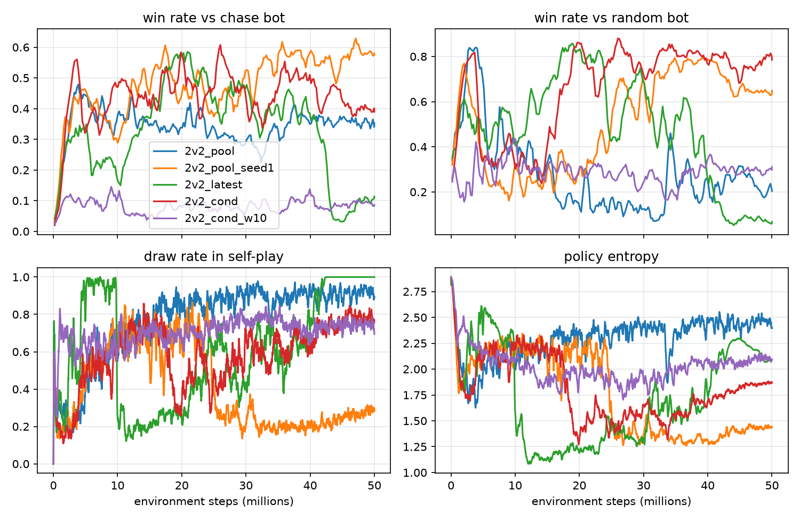

Win rates against the scripted teams are measured on 200 games every 25
updates. `2v2_pool_seed1` climbs to about 60% against the chase team, and its
self-play draw rate stays near 25%. `2v2_pool` levels off near 35%, and its
self-play games become 90% draws. `2v2_cond` stays between 40% and 60% for
most of training. Policy entropy separates the runs too: the stalled
`2v2_pool` stays near 2.45 (the maximum is ln 18 ≈ 2.89), while the
stronger runs fall to 1.4–1.9.

### 5.2 Cross-play and Elo

Same protocol as the midterm: 12 checkpoints per run plus the random and
chase teams, round robin, 200 games per pair. The score counts a win as 1
and a draw as 0.5. Elo is fit to the score matrix with the random team at 0
(`summary.json`, `*/elo.json`).

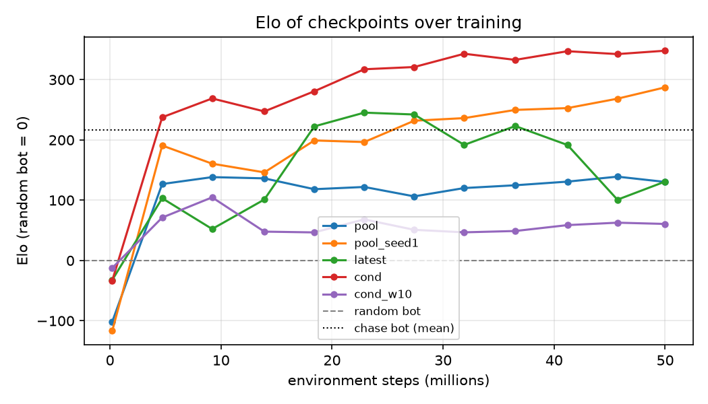

| run | final Elo | peak Elo | later checkpoint beats earlier one | self-play draws, last 50 updates |
|---|---|---|---|---|
| 2v2_pool | 130 | 139 (45.7M) | 53% of pairs | 91% |
| 2v2_pool_seed1 | 287 | 287 (50M) | 92% | 29% |
| 2v2_latest | 131 | 245 (22.9M) | 74% | 100% |
| **2v2_cond** | **348** | **348 (50M)** | **97%** | 77% |
| 2v2_cond_w10 | 61 | 105 (9.2M) | 55% | 73% |

The chase team's rating depends on the pool it is fitted with: it ranges
from 102 to 395 across these runs.

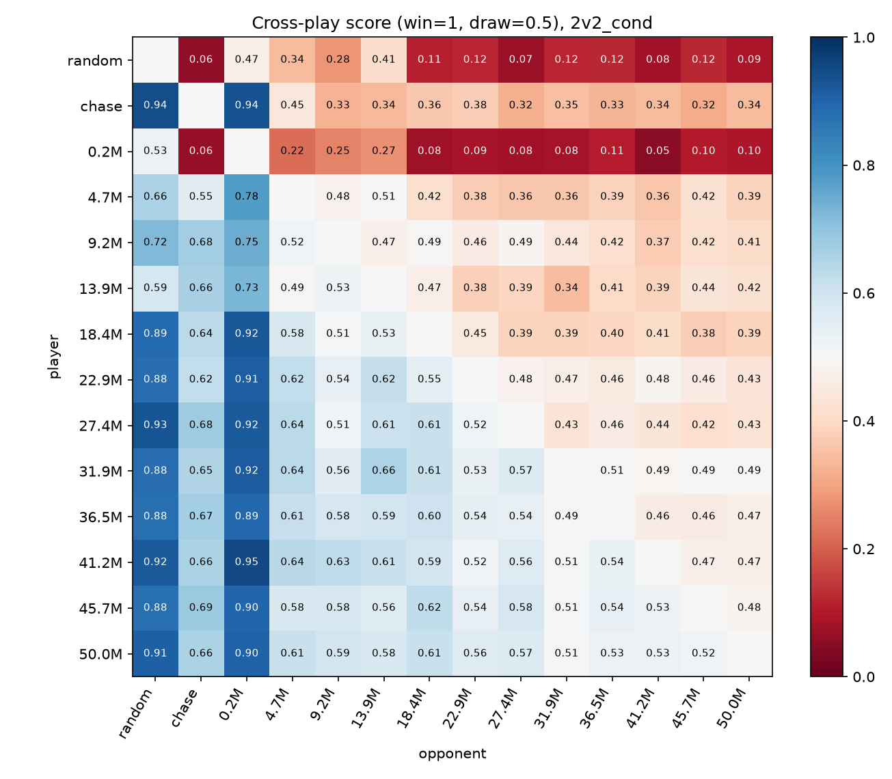

### 5.3 Baselines

Final agents, 1000 games each, sides alternating, W / D / L in %
(`eval.json`). "Mixed" is the agent against a team of one copy of itself
plus one chase player. "Chase partner" puts the agent on a team with a chase
player it never trained with, against the chase team.

| agent | vs random | vs chase | vs mixed | with chase partner vs chase |
|---|---|---|---|---|
| 2v2_pool | 23.9 / 75.3 / 0.8 | 35.2 / 50.3 / 14.5 | 29.0 / 58.3 / 12.7 | 35.2 / 36.0 / 28.8 |
| 2v2_pool_seed1 | 65.4 / 28.3 / 6.3 | **57.8** / 19.2 / 23.0 | 47.8 / 27.3 / 24.9 | 32.4 / 37.2 / 30.4 |
| 2v2_latest | 7.5 / 90.7 / 1.8 | 13.4 / 18.4 / 68.2 | 0.0 / 100 / 0.0 | 20.8 / 22.6 / 56.6 |
| **2v2_cond** | **76.9** / 22.9 / 0.2 | 39.9 / 55.8 / **4.3** | 16.1 / 79.5 / 4.4 | **42.0** / 43.1 / 14.9 |
| 2v2_cond_w10 | 32.4 / 59.2 / 8.4 | 8.9 / 11.2 / 79.9 | 12.1 / 26.2 / 61.7 | 20.2 / 25.7 / 54.1 |

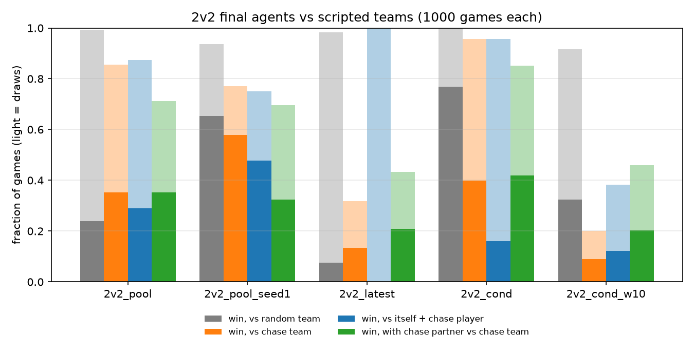

`2v2_pool_seed1` wins the most against the chase team, while `2v2_cond`
almost never loses to it. The same random-player gap as in the midterm
shows up: most learned teams draw a lot against a random team, because
random players jitter in front of their own goal in a way self-play
opponents never do. The collapsed `2v2_latest` draws all 1000 games against
a team made of itself plus a chase player.

**Head-to-head** (score, row vs column, 1000 games):

|  | pool | pool_seed1 | latest | cond | cond_w10 |
|---|---|---|---|---|---|
| pool | – | 0.43 | 0.51 | 0.46 | 0.71 |
| pool_seed1 | 0.57 | – | 0.60 | 0.39 | 0.77 |
| latest | 0.49 | 0.40 | – | 0.24 | 0.50 |
| cond | 0.54 | 0.61 | 0.76 | – | 0.78 |
| cond_w10 | 0.29 | 0.23 | 0.50 | 0.22 | – |

`2v2_cond`, playing the neutral tactic, scores above 0.5 against every other
team. One possible reason: during training its opponents played random
tactics, which works like a more varied opponent pool. That is a guess. I
did not run an experiment to separate it from seed luck.

### 5.4 Latest-only vs pool

The collapse from the midterm comes back, later and less cleanly. The
latest-only run had a first all-draw phase around 6–10M steps (see the
self-play draw curve) and escaped it. Elo kept rising to 245 at 22.9M steps,
then fell. From 42.3M steps on, its self-play games are 100% draws, and by
50M steps it wins 13% against the chase team and loses 68%. Its cross-play
heatmap shows the same picture as the midterm: late checkpoints draw each
other and lose to mid-training ones.

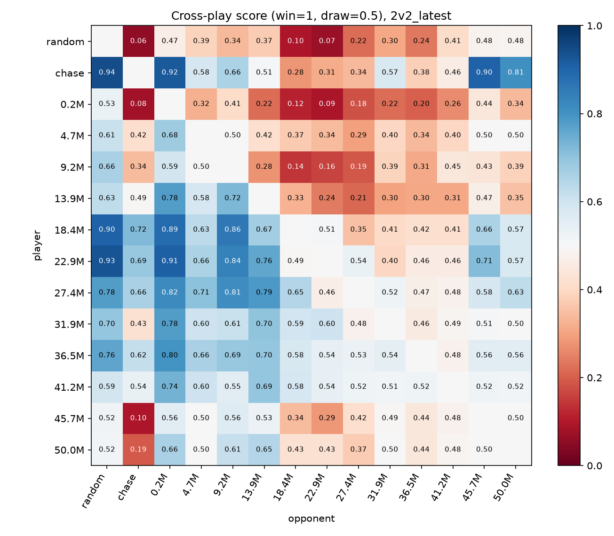

The pool does not fully protect against draw-heavy play in 2v2, though.
`2v2_pool` (seed 0) reaches 91% self-play draws and stops improving after
about 5M steps (later checkpoints beat earlier ones in only 53% of pairs).
It never locks completely and never loses to the random team, but it plays a
cautious game that rarely scores. With one healthy seed and one stalled
seed, I can't give a single number for "the pool recipe in 2v2".

### 5.5 Coordination

Measured over 1000 games against the chase team, with the chase team against
itself as a reference (`eval.json`). A pass is a kick whose next touch is
the teammate. An interception is a kick whose next touch is an opponent.
Depth gap is the mean |x| distance between teammates. Swarm is the share of
steps where both players are within 8 units of the ball.

| team | kicks/game | passes/game | intercepted/game | passes as % of kicks | depth gap | swarm |
|---|---|---|---|---|---|---|
| chase team (scripted) | 3.52 | 0.30 | 2.56 | 8.4% | 31.1 | 0.3% |
| 2v2_pool | 5.45 | 0.23 | 4.58 | 4.3% | 6.9 | 3.1% |
| 2v2_pool_seed1 | 6.37 | **0.99** | 4.32 | **15.6%** | 5.1 | 5.7% |
| 2v2_latest | 2.02 | 0.11 | 1.71 | 5.4% | 7.0 | 1.4% |
| 2v2_cond | 6.30 | 0.41 | 4.93 | 6.5% | 16.9 | 1.8% |
| 2v2_cond_w10 | 1.83 | 0.12 | 1.48 | 6.7% | 41.9 | 0.0% |

The learned teams did not split into a striker and a defender the way the
scripted team does by design. The unconditioned teams play with their two
players 5–7 units apart, against 31 for the chase team, and swarm the ball
more. `2v2_pool_seed1` is the only team that passes noticeably (one pass per
game, 15.6% of its kicks), and it is also the team that wins most against
the chase team. Most kicks from every team end with an opponent touching the
ball next. The conditioned team stands further apart (16.9) even at the
neutral tactic, probably because its training included random `spread`
values.

### 5.6 Does the team follow the tactic?

Each tactic value is set alone to −1, −0.5, 0, 0.5 and 1. Each setting plays
500 games against the chase team and records the matching behavior feature
(game mean, 95% CI) and the win rate (`tactics_cond/tactics.json`). The
dashed line is the unconditioned `2v2_pool` team.

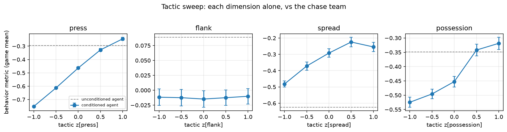

`2v2_cond` (w = 0.002), feature value and win rate vs chase:

| z | −1 | 0 | +1 |
|---|---|---|---|
| press (mean depth) | −0.751 ± 0.006, win 24% | −0.463 ± 0.009, win 38% | −0.245 ± 0.013, win 54% |
| flank (mean y) | −0.012 ± 0.014, win 43% | −0.015 ± 0.014, win 38% | −0.010 ± 0.013, win 38% |
| spread | −0.482 ± 0.019, win 43% | −0.292 ± 0.026, win 38% | −0.254 ± 0.029, win 30% |
| possession | −0.525 ± 0.018, win 25% | −0.452 ± 0.019, win 38% | −0.319 ± 0.022, win 47% |

`press` responds smoothly over its whole range, and the team plays better
when told to press: wins go from 24% at −1 to 54% at +1. `possession` and
`spread` respond with smaller but clearly separated changes. `spread` levels
off above +0.5, and spreading out costs wins. `flank` has no measurable
effect. Even the team's mean y doesn't move. With the small weight, standing
on one wing was never worth enough reward to learn.

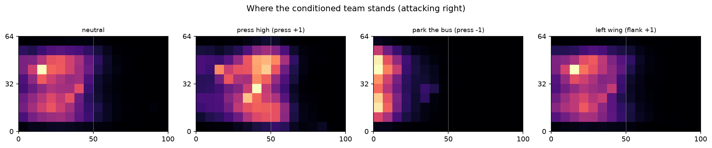

Position heatmaps under four tactics. Told to press, the team moves up to
the halfway line. Told to park the bus, both players pack into their own
goal mouth. Told to play the left wing, it looks the same as neutral.

**Ten times the weight** (`2v2_cond_w10`, w = 0.02):

| z | −1 | 0 | +1 |
|---|---|---|---|
| press | −0.869, win 4% | −0.113, win 9% | +0.286, win 1% |
| flank | −0.625, win 1% | −0.049, win 9% | +0.738, win 5% |
| spread | −0.430, win 1% | +0.400, win 9% | +0.755, win 12% |
| possession | −0.576, win 1% | −0.397, win 9% | −0.290, win 5% |

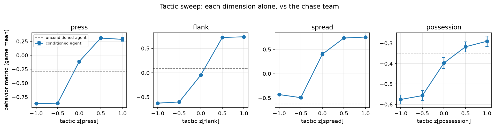

All four tactics now move their features a lot, flank included (−0.63 to
+0.74). The response is close to an on/off switch: −0.5 behaves like −1.
But the team has learned to collect tactic reward instead of winning. It
wins at most 12% against the chase team under any tactic, and its Elo peaked
at 9.2M steps. Between w = 0.002 and 0.02 there is probably a weight that
keeps both, but I only trained these two.

**End to end from text.** Eight phrases go through the coach, and the
resulting z drives the team for 500 games. A requested dimension counts as
followed if its feature moves the right way compared with neutral by more
than its 95% CI. Agent sampling is seeded, so identical z give identical
games.

| phrase set: 8 phrases, 10 requested dimensions | 2v2_cond | 2v2_cond_w10 |
|---|---|---|
| keywords only | 5 / 10 | 8 / 10 |
| keywords, then qwen2.5 3B | 5 / 10 | 9 / 10 |

The failures for `2v2_cond` are the two flank requests, "spread out" (it moves
the right way but by less than its CI), and "let them come at us and
break fast". The keyword parser finds nothing in that last phrase. The LLM
maps it to possession −1, which the w10 team then follows.

### 5.7 The coach

Two hand-written phrase sets with the expected sign of each z value: a dev
set of 32 phrases used while writing the prompt and keywords, and a test set
of 24 that were never used for tuning (`coach_bench.json`). Scores are the
share of z values with the right sign, the share of phrases with all four
right, and median latency on the M5 MacBook Air.

| coach | test: values right | test: phrases all right | dev: values right | median latency |
|---|---|---|---|---|
| keywords | 88.5% | 62.5% | 96.9% | < 1 ms |
| qwen2.5 3B | 79.2% | 37.5% | 83.6% | 1.0 s |
| llama3.2 3B | 67.7% | 20.8% | 85.9% | 0.9 s |
| qwen2.5 7B | 87.5% | 62.5% | 93.8% | 2.0 s |
| keywords, then qwen2.5 3B | **92.7%** | **75.0%** | 96.1% | < 1 ms (LLM on 11 of 24) |
| keywords, then qwen2.5 7B | **92.7%** | **75.0%** | 98.4% | < 1 ms (LLM on 11 of 24) |
| keywords, then Qwen2.5 1.5B in the browser | 78.1% | 54.2% | not run | < 1 ms (LLM on 11 of 24, 1.5 s each) |

On their own, the 3B models are worse than a keyword list, and the 7B model
only matches it. The two fail in different ways. When the keyword parser is
wrong, it usually returns neutral ("take the game to them", "dominate the
ball"). When the LLM is wrong, it returns a confident wrong value ("overload
the right side" became possession +1). Using the keywords when they find
something and the LLM otherwise gets the best of both, and the slow model
runs on fewer than half of the phrases. I picked this hybrid after looking at
the test-set errors, so its 92.7% on the test set is optimistic. The demo
uses the hybrid with qwen2.5 3B.

The last row is the live web page's coach without the local server: the
same keywords in JavaScript, then Qwen2.5-1.5B-Instruct (q4f16_1, about
880 MB) run in the browser by WebLLM, measured once in Cursor's built-in
Chromium browser on the M5 after the model was cached
(`coach_bench_browser.json`). It is worse than keywords alone. On the 11
phrases it handles it gets 54.5% of values right (qwen2.5 3B: 86.4%), it
often adds a confident value nobody asked for ("dominate the ball" became
press +1, spread +1, possession +1), and once it returned cut-off JSON, so
that phrase fell back to neutral.

### 5.8 Recorded matches

| | |
|---|---|
| `2v2_pool_seed1` (red) vs chase team | 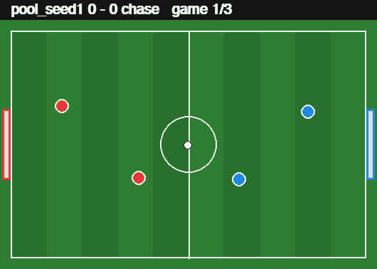 |
| `2v2_cond` told to press high | 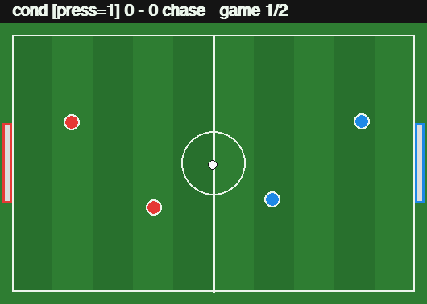 |
| `2v2_cond` told to park the bus | 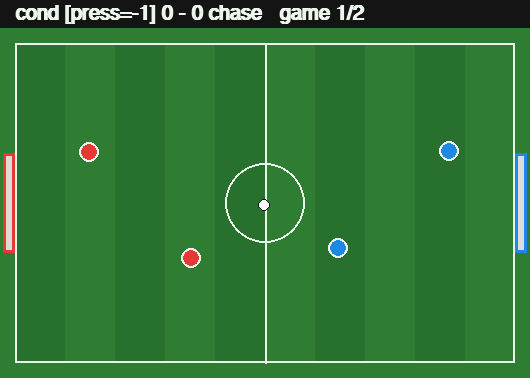 |
| `2v2_cond_w10` told to play left and spread out | 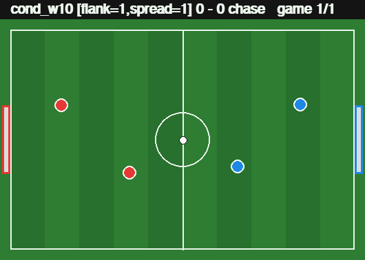 |

## 6. Demo

The browser demo has a 2v2 mode: you and an AI teammate (`2v2_cond`)
against an AI team. A coach panel shows the current tactic as four labeled
bars, with preset buttons (press high, park the bus, left wing, spread out,
keep the ball, …). Run `python scripts/serve_demo.py` and a text box
appears: what you type goes to the local coach, and the teammate plays the
returned tactic. Served as static files (GitHub Pages), the text box runs
the same keyword parser in JavaScript (a test checks it against the Python
one on every benchmark phrase) and sends everything else to Qwen2.5 1.5B
running in the visitor's browser with WebLLM and WebGPU. The first use
downloads the model, with a progress bar in the coach panel. Without WebGPU
only keywords and presets work. The 1v1 mode is unchanged.

`python scripts/play.py --team` does the same in pygame. T cycles the
teammate through the presets.

## 7. Limitations and next steps

- **Seeds.** Two pool seeds ended at +130 and +287 Elo, and each conditioned
  weight has one seed. The tactic results are clear within a run, but which
  recipe gives the strongest team is not settled. The midterm already said
  two seeds were too few, and 2v2 makes that worse.
- **Little real teamwork.** About one pass per game at best, and no stable
  roles. Ideas: reward completed passes early in training, or give each
  player a role input the same way z is given.
- **Flank vs winning.** Left/right play is learnable (w10 learns it) but not
  worth anything for winning. A weight between 0.002 and 0.02, or a weight
  per dimension, is the obvious next run.
- **The coach's test set is small** (24 phrases), and the hybrid was chosen
  after seeing its errors. A fresh phrase set would give an unbiased number.
- **No human study.** The demo logs coach calls, but I didn't run a study of
  people playing with the coached teammate.

## 8. Reproducing

```bash
pip install -r requirements.txt
python -m pytest -q                        # physics (1v1 + 2v2), JS parity, coach tests
python scripts/check_2v2_env.py            # fairness and speed -> results/2v2/env_checks.json
python scripts/train.py --name 2v2_pool --players 2 --seed 0 --total-steps 50e6
python scripts/train.py --name 2v2_pool_seed1 --players 2 --seed 1 --total-steps 50e6
python scripts/train.py --name 2v2_latest --players 2 --opponents latest --total-steps 50e6
python scripts/train.py --name 2v2_cond --players 2 --tactics --total-steps 50e6
python scripts/train.py --name 2v2_cond_w10 --players 2 --tactics --tactic-w 0.02 --total-steps 50e6
python scripts/plot_curves.py runs/2v2_pool runs/2v2_pool_seed1 runs/2v2_latest runs/2v2_cond runs/2v2_cond_w10 --out results/2v2/learning_curves.png
for r in pool pool_seed1 latest cond cond_w10; do python scripts/crossplay.py runs/2v2_$r --out results/2v2/$r; done
python scripts/plot_elo_compare.py results/2v2/{pool,pool_seed1,latest,cond,cond_w10} --out results/2v2/elo_compare.png
python scripts/summarize_2v2.py pool pool_seed1 latest cond cond_w10
python scripts/eval_2v2.py runs/2v2_pool runs/2v2_pool_seed1 runs/2v2_latest runs/2v2_cond runs/2v2_cond_w10
ollama pull qwen2.5:3b-instruct            # also llama3.2:3b and qwen2.5:7b-instruct for the benchmark
python scripts/coach_bench.py --models qwen2.5:3b-instruct llama3.2:3b qwen2.5:7b-instruct
python scripts/tactics_eval.py runs/2v2_cond --reference runs/2v2_pool --out results/2v2/tactics_cond
python scripts/tactics_eval.py runs/2v2_cond_w10 --reference runs/2v2_pool --out results/2v2/tactics_cond_w10
python scripts/serve_demo.py               # web demo with the coach at http://localhost:8000
python scripts/play.py --team              # pygame 2v2 with a coachable teammate
```
